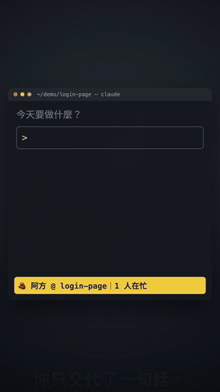
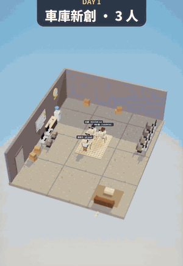

# Cubbi

Run a crew of coding agents on your own computer — watch them in a 3D office, and steer them from your phone.

<p align="center">
  
  &nbsp;&nbsp;
  
</p>
<p align="center"><sub>Left: what you type in Claude Code shows up in the office. Right: the office grows with your real usage.</sub></p>

Every Claude Code session is a coworker at a desk: typing when it edits files, running to the terminal when it runs commands, raising a hand when it needs you, and taking a coffee break when it's done.

Cubbi comes in two sizes:

| | What it does | Start it |
|---|---|---|
| **The office** | Watch your sessions — read-only, nothing to configure | `npx cubbi` |
| **Remote** | Everything in the office, plus: talk to your agents, approve their commands, review their branches and get pushed to your phone when they need you | `npx cubbi setup` |

Cubbi runs on your machine and talks to the agents on your machine. It is not affiliated with Anthropic or OpenAI.

---

## The office

```sh
npx cubbi
```

**Or let your agent set it up.** Paste this into Claude Code:

> Set up Cubbi for me (https://github.com/ishoplus/cubbi): check that `node --version` is 20 or newer, run `npx cubbi install-hooks`, then tell me to run `npx cubbi` in its own terminal and start a new Claude Code session.

Background tasks show up as helpers at the hot desks, and Codex runs as contractors. The office **grows with the work you actually do** — from a garage startup to a headquarters — with couriers delivering new monitors, a coffee bar, a game corner and office cats along the way.

### Live updates (recommended)

Out of the box Cubbi reads your Claude Code logs, so it can lag a few seconds. And there is one moment the logs never show: **Claude Code doesn't write permission prompts to its logs**, so anything that only reads them can't tell a session that is waiting for your approval from one that is still running.

With hooks, Claude Code tells Cubbi the moment it asks for permission: that coworker raises a hand right away (with a browser notification, if you allow them), and you also see the command that is running right now. To turn them on:

```sh
npx cubbi install-hooks     # adds a few hooks to ~/.claude/settings.json (backs it up first)
npx cubbi uninstall-hooks   # removes only what Cubbi added
```

The hook sends events to Cubbi on your machine only, adds about 0.1 s per event, and never blocks Claude: if Cubbi isn't running it just exits.

It also adds two small touches inside Claude Code (skipped if you already have your own):

- **Status line** — `🧱 Ah-Fang @ login-page | 3 busy · Small studio`: which figure this session is, right in your terminal
- **`/cubbi`** — opens the office and flies to this session's figure

And when you send a message, a little "you" walks over to that coworker's desk and hands over a sticky note with what you typed.

### Their point of view

Pick someone and press the eye button in their panel (or **V**) to strap the camera to their head: you see their hands on the keyboard as they type, or the office from a cat's height. Press **V** again to hop to each cat in turn, and **Esc** or "Leave POV" to get the normal camera back.

### Streaming your office

```sh
npx cubbi --stream 4322
```

Also serves a redacted copy of the office on `127.0.0.1:4322` for a live stream (add it to OBS as a Browser Source, 1920×1080). Everything you type, every title, command and file path is stripped; projects become departments and sessions get nicknames that stay the same across restarts (`~/.cubbi/stream-names.json`). Deliverables, images and buttons are hidden, and nothing can be changed from that port. Figures still walk, type, run commands and raise hands in real time.

The stream page directs itself: close-ups that follow whoever is busy, cutting to anyone who raises a hand or finishes, with an occasional wide shot. To take over, open `http://127.0.0.1:4321/stream-control` (only on the main port; it shows real titles next to the nicknames) and pick auto, wide, a department, a person, someone's point of view, a cat's point of view or an area. Auto mode also cuts to a point-of-view shot now and then. Sound effects (typing near the camera, raised hands, finished work) are on by default in the stream page; enable "Control audio via OBS" on the Browser Source to capture them. A small "Cubbi · npx cubbi" badge sits in the bottom-right corner; add `--no-badge` to hide it.

---

## Remote: your agents, from your phone

```sh
npx cubbi setup
```

The setup walks you through it in about two minutes: it checks that Claude Code is installed and signed in, asks which folder your agents may work in and how your phone should reach this computer, offers to start on boot, then opens the browser on this computer (already signed in) and prints a QR code for your phone.

**Or let your agent set it up.** Paste this into Claude Code or Codex:

> Run `npx --yes cubbi setup-guide` and follow the steps it prints to install Cubbi remote for me, so I can use Claude Code from my phone. Ask me which folder it may work in and how my phone should connect before you install anything.

The guide tells the agent to install globally and run Cubbi as a background service (so its own command doesn't hang), and to give you the phone link and a 6-digit pairing code in the chat — QR codes printed inside an agent's tool output are usually hidden from you.

### What you get

- **Chat and approve from anywhere.** Send messages, answer questions, allow or deny commands. Conversations keep running when your phone sleeps, when you switch networks, and when Cubbi itself restarts.
- **An inbox with push notifications.** Questions waiting for you, finished work, stuck agents, unexpected exits — one list, the same in the office and on your phone, with a push for each new item.
- **One branch per agent.** Tick *Branch* when you start a conversation: the agent works in its own git worktree and commits there. When it's done you get the diff and your project's checks (tests, lint, build) on the delivery card, and merge, send it back with a note, or discard it — with one tap. Merging only touches your machine; nothing is pushed.
- **Claude Code and Codex.** If the Codex CLI is installed and signed in, you can pick it for a conversation. Same chat, same approvals, same inbox and branches.
- **An ideas department.** Every day (if you turn it on) it reads your projects and hands in three proposals. Answer yes / no / tweak; a yes can be started with one tap, on its own branch.
- **A schedule wall.** Routines that start on time — the daily proposals, a nightly test run, any command or any instruction for an agent — on a calendar in the office.
- **The office, with a reason to come back.** Real results (finished turns, commits, delivered work) earn bricks; departments buy equipment and the company levels up.

### Reaching your computer from your phone

Cubbi listens on `127.0.0.1` only. Choose one way in during setup (run `npx cubbi setup` again to change it):

| | Works away from home | Notes |
|---|---|---|
| **Tailscale** (recommended) | ✓ | Only your own devices can connect; HTTPS without a domain. Install it on the computer and the phone, sign in to the same account, and turn on MagicDNS and HTTPS in the admin console. |
| **Same Wi-Fi** | — | Plain `http` on your local network: only use it on networks you trust. |
| **ngrok** | ✓ | Needs a free [authtoken](https://dashboard.ngrok.com/get-started/your-authtoken). |
| **Your own URL** | ✓ | A tunnel you run yourself (e.g. a named cloudflared tunnel) pointing at `http://127.0.0.1:17000`. Quick tunnels (`trycloudflare`) don't support streaming and won't work. |

Not sure which to pick? `cubbi doctor` checks this computer — whether Tailscale is installed and set up, whether a proxy or VPN is running, and whether Tailscale's and ngrok's servers are reachable from here — and says what to watch out for. A few things worth knowing:

- **A phone can run only one VPN at a time.** If your phone needs another VPN (Shadowrocket, a work VPN) to get online, it has to switch to Tailscale to reach Cubbi; ngrok or your own URL work without switching.
- **Proxy tools in TUN / enhanced mode** on this computer (Shadowrocket, Clash, Surge…) must send `100.64.0.0/10` and `*.ts.net` DIRECT, or Tailscale won't receive the phone's traffic.
- **Tailscale and ngrok can be unreliable in some countries** (mainland China, for example).

To sign in another device, press 📱 in the top-right corner of the page (or run `cubbi remote login-link`) and scan the QR code. Can't scan — say, the app on your iPhone home screen, which doesn't share Safari's sign-in? Type the 6-digit pairing code shown under the QR code on the sign-in screen instead. Links and codes work once and expire after 10 minutes.

### Start on boot

```sh
npm i -g cubbi            # a fixed install location (npx caches get cleaned up)
cubbi service install     # starts on boot, restarts if it crashes (launchd on macOS, systemd on Linux)
cubbi service status      # running? version, port, public URL
cubbi service restart     # safe restart: syntax check, trial run on a spare port, wait until idle, swap
cubbi service logs -f     # follow the log
cubbi service uninstall   # also removes the Tailscale forwarding Cubbi set up
```

Agents run in their own processes, so restarting Cubbi never interrupts a conversation.

### Commands

```sh
cubbi setup [--yes --work-root <dir> --connect local|lan|tailscale|ngrok|url --ngrok-token <t> --url <https://…> --service|--no-service]
cubbi remote [--port 17000]            # run in this terminal instead of as a service
cubbi remote login-link [--public]     # one-time login link + QR (--public: don't remember that device)
cubbi ideas run|list|verdict <id> <yes|no|tweak> [note]|lenses
cubbi install-skills                   # adds Cubbi's skills to Claude Code: cubbi-setup, cubbi-ideas
cubbi setup-guide                      # install steps for an agent (Claude Code, Codex…)
cubbi doctor [--json]                  # check Tailscale, proxies/VPNs and reachability before choosing a connection
```

### Configuration

Connection settings and secrets live in `~/.cubbi/.env` (only readable by you):

| Key | |
|---|---|
| `WORK_ROOT` | The folder your agents may work in (and everything under it) |
| `HOST`, `PORT` | `127.0.0.1` / `17000` by default; `HOST=0.0.0.0` for same-Wi-Fi access |
| `TUNNEL` | `none`, `tailscale`, `ngrok` or `external` (with `CLAUDE_WEB_URL`) |
| `ACCESS_TOKEN` | The master password, generated on first run; only local commands use it |
| `PUSH_URL` | An [ntfy](https://ntfy.sh) topic URL for push notifications |
| `ALLOW_BYPASS=1` | Offer the "allow everything" permission mode (off by default) |
| `LOGIN_EMAIL`, `LOGIN_EMAIL_FROM`, `SMTP_*` / `RESEND_API_KEY` | Optional sign-in by email code |

Everything else lives in `~/.cubbi/remote/config.json`:

```json
{
  "plugins": { "economy": true, "ideas": true, "schedule": true },
  "ideas": { "roots": ["~/projects"], "values": "What I care about…", "web": false },
  "routines": [
    { "id": "ideas", "name": "Daily ideas", "at": "09:00", "days": "daily", "action": { "type": "ideas" } },
    { "id": "tests", "name": "Nightly tests", "at": "02:00", "days": "weekdays",
      "action": { "type": "prompt", "cwd": "~/projects/app", "prompt": "Run the tests and fix what's broken." } }
  ],
  "drivers": { "codex": "auto", "default": "claude" },
  "projects": { "my-app": { "driver": "codex" } },
  "inbox": { "push": ["ask", "idea", "deliv", "review", "stuck", "ended", "task"], "pushDetail": "brief" },
  "space": { "lang": "en", "weather": { "lat": 25.03, "lon": 121.5, "place": "Taipei" } }
}
```

### Security

Remote lets whoever is signed in operate this computer through your agents, so treat a signed-in device like your laptop:

- **Signing in.** One-time login links or 6-digit pairing codes (10 minutes, single use; 20 wrong codes pause pairing for an hour), or optional email codes. Sessions are stored hashed; you can see and revoke signed-in devices (🔒). Devices marked "someone else's computer" are forgotten when the browser closes.
- **What a signed-in device can do.** Everything your agents can do in `WORK_ROOT`, plus run the commands in routines and project checks. "Allow everything" is off unless you set `ALLOW_BYPASS=1`.
- **Files your agents write.** HTML and SVG files from your work folder are shown sandboxed: they can't run scripts or reach your sign-in.
- **The network.** Cubbi only listens on `127.0.0.1` unless you choose otherwise. Same-Wi-Fi mode is unencrypted `http`; use Tailscale outside your home or office.
- **Push notifications.** ntfy topics are public to anyone who knows the name, so by default a push only says who needs what (`pushDetail: "brief"`), never the command or file. Use a hard-to-guess topic, or your own ntfy server, before switching to `"full"`.
- **The ideas department** reads your projects with read-only tools and no web access by default (`"web": true` turns WebSearch/WebFetch on).

---

## Privacy

Cubbi reads local files only — `~/.claude/projects` (and `~/.codex` if you use Codex) to draw the office and count results — and never uploads them. The only network traffic is what you set up: your tunnel, push notifications if you set `PUSH_URL`, and weather if you set a location. Its own data lives in `~/.cubbi`.

## Requirements

Node 20+ and [Claude Code](https://docs.anthropic.com/claude-code). The office works on macOS, Linux and Windows; remote and `cubbi service` on macOS and Linux.

## Embedding

Cubbi is also a library: a host app can add its own session sources, actions (reply, answer, new session) and plugins. See `server/index.js`, `web/space/host.js` and `remote/plugins.js`.

## License

MIT, except the background music in `web/space/music/` (all rights reserved; it may only be played inside Cubbi). See [web/space/music/LICENSE.md](web/space/music/LICENSE.md).
